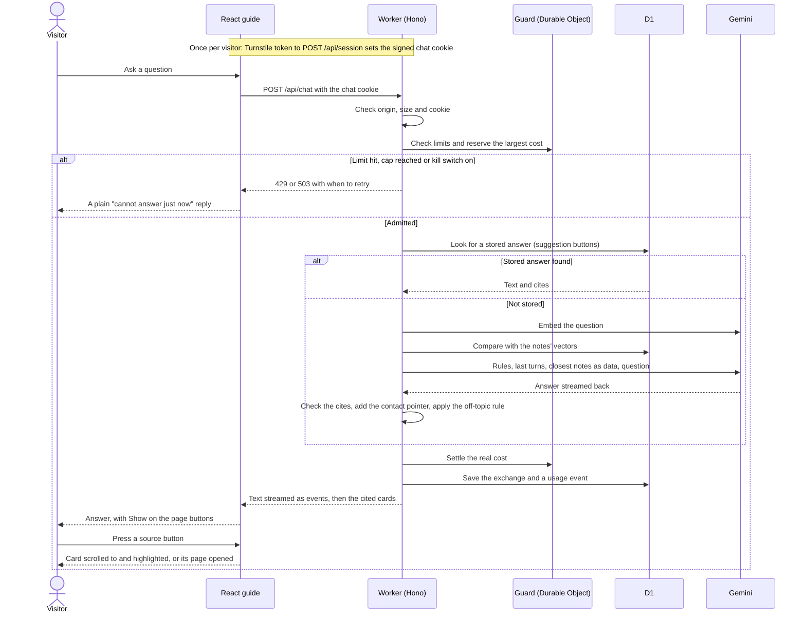

# Assistant Request Sequence

Status: implemented. The session is created once, before the first question; each question is then one chat request.

The model call stays outside the Durable Object, so a retry cannot spend twice. A cached answer skips the model but still passes the limits. After a cancelled request, a late response is ignored by the page.
