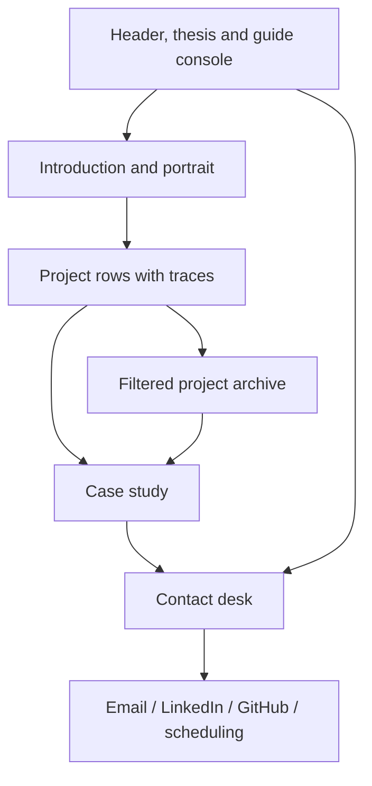

# UI Flow

## Publication

The header shows the owner's name. The hero leads with the thesis about making AI useful through production engineering, then the guide console. Visual rules are in the [design language](design-language.md).

## Assistant

Automatic text greeting → visitor opens guide → typed question or explicit microphone activation → listening/thinking → concise answer with citations → scroll and spotlight → visitor may open case study or ask for more depth.

The persistent control is dismissible. Desktop uses an inset panel; narrow screens use an expandable bottom sheet with safe-area and virtual-keyboard handling. Avoid covering contact actions or locking the page scroll unnecessarily. Return focus to the launcher after closing. Announce status using a restrained live region.

## States

| State | UI behavior |
| --- | --- |
| Idle/greeting | Brief text, suggested portfolio questions, no automatic paid inference or audio. |
| Listening | Explicit microphone indicator, stop control, text alternative. |
| Thinking | Progress label and cancellation; prevent accidental duplicate submission. |
| Answering | Text first; optional audio with stop/mute controls. |
| Navigating | Highlight known project; respect reduced motion; preserve visitor control. |
| Rate-limited | Explain reset/fallback; static suggested answers may remain available. |
| Failed | Specific recoverable error; keep the transcript and typed input usable. |

## Desktop and Mobile

Desktop supports two-column rows and comfortable line lengths; mobile stacks content in its semantic order. Traces wrap and shrink rather than scroll. The tools list becomes a single column. Test mouse, keyboard, touch, orientation, and screen readers.

See [design language](design-language.md), [wireframes](wireframes/README.md), and [assistant sequence](sequence-diagrams/assistant.md).
