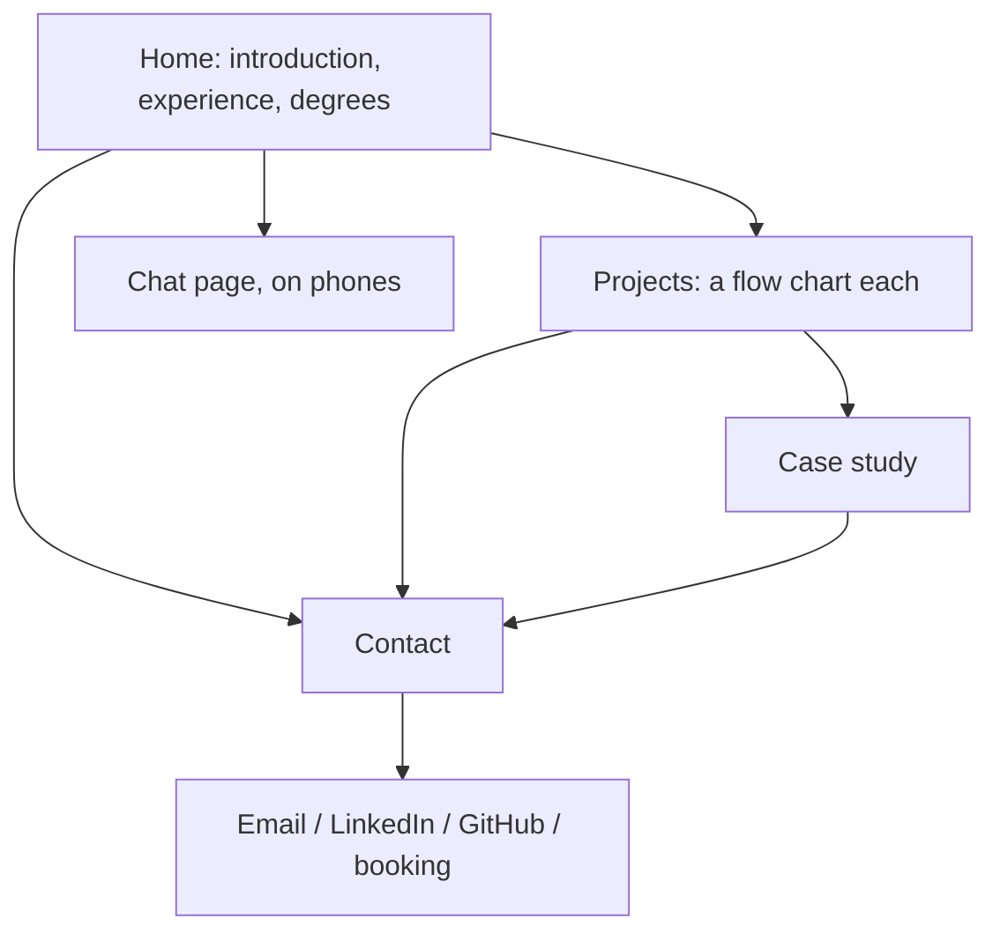

# UI Flow

## Publication

The header shows the owner's name, Projects, Contact and GitHub. The home page opens with a short introduction, the résumé button and profile links, then the engineering experience and the degrees. A wide screen has a guide panel on the right; a phone has a launcher that opens the chat as a page of its own. Visual rules are in the [design language](design-language.md).

## Assistant

The visitor opens the guide, asks a typed question or taps a suggestion, sees a short thinking state, then a concise answer with source buttons. A source button scrolls to and highlights the card on the page, or opens the page that has it. The visitor can ask for more, delete the chat, or rate an answer.

On wide screens the panel is a column that leaves the page scrollable. On phones the chat is `/chat/`: the launcher shrinks to the mascot while the page scrolls, a tap opens the chat, and the back arrow returns to where the visitor was. After a suggestion is tapped on a phone, the other suggestions go away. Return focus to the launcher when the panel closes. Announce status with a restrained live region.

## States

| State | UI behavior |
| --- | --- |
| Idle | A short line saying what the guide answers from, suggested questions, no automatic paid answer. The mascot sleeps after 40 seconds. |
| Thinking | The mascot looks thoughtful and a progress label shows; a second submission is held until the answer finishes. |
| Answering | The text streams in; the mascot talks; the source buttons appear at the end. |
| Not about Yash | A fixed one-line reply, with no contact card. |
| Not in the notes | A plain statement, then a pointer to the contact page. |
| Rate-limited or resting | An explanation of when to try again; the rest of the site works. |
| Failed | A recoverable message; the transcript and the typed text are kept. |

Voice was designed but not built ([voice sequence](sequence-diagrams/voice.md)).

## Desktop and mobile

Desktop supports two-column rows and comfortable line lengths; mobile stacks content in its semantic order. The flow charts turn from left to right to top to bottom below 540 px. The résumé button says Downloading… while it waits. Test with mouse, keyboard, touch, orientation and a screen reader.

See [design language](design-language.md), [wireframes](wireframes/README.md) and the [assistant sequence](sequence-diagrams/assistant.md).
